  

# 🚀 Awesome VMware vSphere Cloud Backup & Instant Recovery 🛡️

  
  
  
  
  
  
  

> 🌐 A curated directory of industry-leading **VMware vSphere Cloud Backup**, **Instant Recovery**, **Disaster Recovery as a Service (DRaaS)**, and **Enterprise Data Protection** platforms. ⚡ Features comprehensive benchmarking for enterprise SaaS/hosted solutions and top open-source tools protecting VMware ESXi and vCenter virtual machines against ransomware, downtime, and data loss.
>
> 🌟 **Star this repository if you find it helpful!** 🌟

---

## 📑 Table of Contents

- [📈 Sector Overview & Market Dynamics](#-sector-overview--market-dynamics)
- [🟦 SaaS & Commercial Enterprise Platforms](#-saas--commercial-enterprise-platforms)
- [🟩 Open-Source Backup Software](#-open-source-backup-software)
- [📊 Feature Matrix & Architectural Comparison](#-feature-matrix--architectural-comparison)
- [🔍 Evaluation Criteria & Key Considerations](#-evaluation-criteria--key-considerations)
- [💖 Support & Community](#-support--community)
- [⭐ Star History](#-star-history)
- [🤝 Contributing](#-contributing)
- [📄 License](#-license)

---

## 📈 Sector Overview & Market Dynamics 📊

The global enterprise backup and disaster recovery software market is valued at approximately **$10.5B to $11.5B in 2024–2025** and is projected to expand to over **$17B to $20B by 2030**, representing a compound annual growth rate (CAGR) of **~9.8% to 10.5%** 🚀. 

The sector is **moderately to highly fragmented** rather than a winner-take-all monopoly: while legacy hardware conglomerates (Dell Technologies) and multi-billion-dollar market pioneers (Veeam, Rubrik, Cohesity) control significant enterprise market share 🏢, persistent ransomware threats 🔒, broad VMware licensing shifts 📑, and containerized multi-cloud adoption ☁️ have created strong demand for specialized SaaS providers (Druva, HYCU) and open-source alternatives 💡.

---

## 🟦 SaaS & Commercial Enterprise Platforms 💼

Commercial VMware vSphere backup and recovery software ranked descending by company size (market capitalization, enterprise valuation, or annual revenue) 🏆.

| Solution | Company Scale (Valuation / Revenue) | Starting Pricing (Specific Tier) | Free Tier / Trial Limit | Key Architecture & VMware Capabilities |
| :--- | :--- | :--- | :--- | :--- |
| **[Dell PowerProtect Data Manager](https://www.dell.com/en-us/dt/data-protection/powerprotect-data-manager.htm)** 🖥️ | **$95.57B** (FY25 Revenue) | **$1,800.00 / year** (entry Data Domain Virtual Edition 1TB license tier via AWS Marketplace / Dell Partner) | **90-Day Free Trial** (Full-featured software trial up to 500 GB protected capacity) | Transparent Snapshots (TSDM) removing proxy bottlenecks, direct vCenter orchestration, native Data Domain deduplication, and PowerProtect cyber recovery vaults. 🛡️ |
| **[Rubrik VMware Protection](https://www.rubrik.com/solutions/virtualization)** 🔒 | **~$22.0B** (Public Market Cap, NYSE: RBRK) | **$2,500.00 / year** (Starting Enterprise Edition baseline quote per protected socket/TB bundle) | **30-Day Free Trial** (Rubrik Security Cloud sandbox with simulated ransomware investigation) | Zero-trust data security, automated SLA domains, immutable append-only file systems (Atlas), Continuous Data Protection (CDP), and near-zero RTO instant recovery. ⚡ |
| **[Cohesity DataProtect](https://www.cohesity.com/products/dataprotect/)** 🌐 | **~$7.5B** (Private Valuation; post-Veritas DP merge) | **$2,425.00 / month** ($29,100/yr for 10 BETB entry tier on AWS Marketplace) | **30-Day Free Trial** (Cohesity DataProtect as a Service up to 5 TB backend storage) | Hyperconverged web-scale architecture, vSphere 9 support, FortKnox cloud cyber vaulting, AI-assisted recovery agents, and instant mass restore. 🤖 |
| **[Commvault Cloud](https://www.commvault.com/supported-technologies/vmware)** ☁️ | **~$6.5B** (Public Market Cap, NASDAQ: CVLT) | **$58.50 / TB / month** (or ~$1,795.00/TB/yr foundational enterprise tier) | **30-Day Free Trial** (Full access to Commvault Cloud SaaS for up to 10 VMs and 1 TB storage) | Agentless Change Block Tracking (CBT), deep vCenter & VMware Aria Automation integration, granular item-level restore, and integrated Threat Scan. 🔍 |
| **[Acronis Cyber Protect](https://www.acronis.com/en-us/products/cyber-protect/)** 🛡️ | **$3.5B+** (Valuation via EQT buyout) | **$85.00 / VM / year** (Standard Virtual Machine license; or ~$5.00/VM/mo via MSP partner tiers) | **30-Day Free Trial** (Full protection for up to 5 virtual machines with 1 TB Acronis Cloud Storage) | Unified cyber protection integrating AI-based behavioral anti-ransomware, cross-hypervisor VM migration, near-instant VM spin-up via run-from-backup, and immutable cloud storage. 🔄 |
| **[Veeam Backup & Replication](https://www.veeam.com/vmware-esxi-backup.html)** ⚡ | **$2.0B+** (Annual Recurring Revenue, Private) | **$95.00 / workload / year** (Veeam Data Platform Essentials, sold in packs of 5 at $475.00/yr) | **30-Day Free Trial** (Full Enterprise Plus features, unlimited VMs) + **Community Edition: Forever Free up to 10 workloads/VMs** | Industry-standard vSphere backup, instant VM recovery (vPower NFS), SureBackup automated boot verification, continuous data protection (CDP), and multi-cloud tiering. 🎯 |
| **[Veritas NetBackup](https://www.veritas.com/protection/netbackup)** 💾 | **~$1.8B** (Estimated Enterprise Annual Revenue) | **$1,500.00 / year** (NetBackup IT Analytics Foundation base license starter pack) | **60-Day Free Trial** (Full software evaluation of NetBackup Virtual Appliance for VMware) | NetBackup Accelerator for VMware synthesizing full backups from incrementals, agentless VMDK indexing, vCenter plug-in, and instant recovery via MSDP storage. 📦 |
| **[Druva VMware Backup](https://www.druva.com/solutions/vmware-backup)** ☁️ | **~$1.0B** (Valuation; >$200M ARR) | **$200.00 / VM / year** (or ~$17.00/VM/mo starting tier; $210/TB/mo consumption credit tier) | **30-Day Free Trial** (Full enterprise capabilities up to 1 TB deduplicated backup data) | 100% SaaS-delivered agentless protection, global source-side deduplication, CloudCache local appliance for sub-5 minute LAN RTOs, and direct-to-cloud air-gapped isolation. 🚀 |
| **[HYCU for VMware](https://www.hycu.com/solutions/vmware)** 🦄 | **~$400M** (Valuation; Series B) | **$416.66 / month** ($5,000.00/yr Starter Bundle covering up to 50 VMs and 10 TB) | **14-Day Free Trial** (Complete HYCU Protégé suite protecting up to 25 VMs) | Purpose-built agentless backup using native vSphere API communication, 1-click disaster recovery spin-up, zero performance overhead on hypervisor hosts, and WORM cloud targets. ✨ |
| **[NAKIVO Backup & Replication](https://www.nakivo.com/vmware-backup/)** 💰 | **~$25M** (Annual Revenue) | **$2.45 / workload / month** (Pro Essentials, billed annually at $29.40/VM/yr; or $229.00 perpetual per socket) | **15-Day Free Trial** (Full Pro edition features, unlimited workloads) + **Free Edition: Forever Free up to 10 VMs** | Lightweight footprint (deployable directly onto NAS appliances), Change Block Tracking, physical-to-virtual (P2V) recovery, direct tape archive, and instant VM booting. 🚀 |

---

## 🟩 Open-Source Backup Software 🔓

Self-hosted, transparent, and community-audited tools capable of VMware vSphere VM backup, VMDK snapshot extraction, or host-level data protection. Sorted descending by GitHub Stars_Count ⭐.

| Project | GitHub_Stars | Primary Stack & License | VMware Integration & Instant Recovery Capability |
| :--- | :--- | :--- | :--- |
| **[Restic](https://github.com/restic/restic)** 🛡️ |  | Go • BSD-2-Clause | Cryptographically secure, deduplicated backup program. Protects VMware guests at file/OS level and VMDK raw image snapshots; mounts repositories via FUSE for fast file extraction. ⚡ |
| **[Kopia](https://github.com/kopia/kopia)** 💎 |  | Go • Apache-2.0 | High-performance fast backup tool with client-side end-to-end encryption and deduplication. Features GUI/CLI, multi-cloud repository targets (S3/Wasabi/Azure/GCS), and rapid directory snapshot recovery. ☁️ |
| **[BorgBackup](https://github.com/borgbackup/borg)** 🗄️ |  | Python / C • BSD-3-Clause | Deduplicating backup engine with authenticated encryption. Ideal for backing up ESXi exported OVA/OVF appliances and mounted NFS datastore VMDK directories with minimal storage consumption. 🔐 |
| **[ghettoVCB](https://github.com/lamw/ghettoVCB)** 📜 |  | Shell (ESXi POSIX) • MIT | The legendary ESXi native shell script utilizing VMware `vim-cmd` and `vmkfstools` to perform live online VM snapshots and backups directly on standalone ESXi or vCenter hosts to local/NFS storage. 🛠️ |
| **[Bareos](https://github.com/bareos/bareos)** 🐻 |  | C++ • AGPL-3.0 | Cross-network enterprise backup suite featuring a native **vmware-plugin** using VDDK (Virtual Disk Development Kit). Supports agentless VM snapshots, Change Block Tracking (CBT), disk/tape targets, and WebUI restore. 🖥️ |
| **[UrBackup](https://github.com/uroni/urbackup_backend)** 🔄 |  | C++ • AGPL-3.0 | Client/server backup system providing fast image and file backups for physical hosts and VMware guest VMs with deduplication and web-based bare-metal recovery media. 💾 |
| **[Proxmox Backup Server](https://github.com/proxmox/proxmox-backup)** 🦀 |  | Rust • AGPL-3.0 | Enterprise client-server backup solution with deduplication and authenticated encryption. Provides generic client-level protection for VMware guest machines and facilitates seamless VM migration from VMware to Proxmox VE. 🚀 |

---

## 📊 Feature Matrix & Architectural Comparison 🧩

| Solution | Deployment Architecture | Instant VM Boot | CBT Support | Immutable / Ransomware Vault | Multi-Cloud Replication | Best For |
| :--- | :--- | :---: | :---: | :---: | :---: | :--- |
| **Dell PowerProtect** 🖥️ | On-Prem Appliance / Software | ✅ | ✅ | ✅ (Cyber Recovery Vault) | AWS, Azure, Google Cloud | Large Dell EMC enterprise environments |
| **Rubrik** 🔒 | Zero-Trust Appliance / SaaS | ✅ (Near-zero RTO) | ✅ | ✅ (Atlas Air-Gap) | AWS, Azure, Google Cloud | Zero-Trust enterprise cyber recovery |
| **Cohesity** 🌐 | Hyperconverged Appliance / SaaS | ✅ (RecoveryAgent) | ✅ | ✅ (FortKnox SaaS Vault) | Azure, AWS, Google Cloud | Cyber resilience & rapid petabyte recovery |
| **Commvault Cloud** ☁️ | Hybrid SaaS / Managed Platform | ✅ | ✅ | ✅ (Air Cove / Metallic) | AWS, Azure, OCI, GCP | Complex heterogenous enterprise workloads |
| **Acronis Cyber Protect** 🛡️| SaaS / On-Prem / MSP Console | ✅ (Run-from-backup) | ✅ | ✅ (Cloud Immutability) | Acronis Cloud, AWS, Azure | SMBs, MSPs, and cross-hypervisor migration |
| **Veeam** ⚡ | Software (Windows / Linux) | ✅ (vPower NFS) | ✅ | ✅ (Hardened Linux Repository) | S3 Object Storage, Azure, Wasabi | Universal VM backup standard & verified restore |
| **Veritas NetBackup** 💾 | Hardware / Virtual Appliance | ✅ | ✅ (Accelerator) | ✅ (NetBackup WORM) | Multi-cloud enterprise tiers | Standardized legacy enterprise infrastructures |
| **Druva** ☁️ | 100% Cloud SaaS | ✅ (CloudCache TurboTier)| ✅ | ✅ (AWS Air-Gapped Cloud) | Native AWS Global Cloud | Zero on-prem infrastructure footprint |
| **HYCU** 🦄 | Agentless Virtual Appliance / SaaS | ✅ | ✅ | ✅ (WORM Storage Targets) | AWS, Azure, Google Cloud | Simple 1-click cloud data mobility |
| **NAKIVO** 💰 | Linux / Windows / NAS Container | ✅ (Flash VM Boot) | ✅ | ✅ (S3 Object Lock / Linux WORM) | AWS, Wasabi, Azure, Backblaze | High-ROI backup for budget-conscious SMBs |
| **Bareos** 🐻 | Self-Hosted Open-Source Server | ❌ (Full restore) | ✅ (VDDK Plugin) | ✅ (via S3 Object Lock) | S3-compatible, Tape, NAS | Open-source enterprise data centers |
| **ghettoVCB** 📜 | ESXi Native POSIX Script | ❌ (Cold restore) | ❌ | ❌ (Scripted manual rotation) | NFS, VMFS local mounts | Lightweight standalone ESXi without vCenter |

---

## 🔍 Evaluation Criteria & Key Considerations 🎯

When designing a VMware vSphere backup and instant disaster recovery architecture, consider the following parameters:

1. **⏱️ Recovery Time Objective (RTO) & Instant Recovery Mechanism:** Instant recovery mounts backup images directly to ESXi datastores via NFS/iSCSI without waiting for complete disk extraction. Verify if your vendor supports instant live vMotion (Storage vMotion) while the VM is active.
2. **🎯 Recovery Point Objective (RPO) & Continuous Data Protection (CDP):** If near-zero data loss is mandatory, verify whether the software supports VMware vSphere APIs for I/O Filtering (VAIO) for continuous block replication.
3. **🔄 VMware vSphere Compatibility:** Verify compatibility with modern VMware releases (vSphere 7.0u3, 8.0u2, and vSphere 9.0) and compatibility with VMware Cloud Foundation (VCF).
4. **🛡️ Ransomware Defense & Air-Gapping:** Ensure backup repositories support immutable WORM (Write Once, Read Many) locks, such as hardened Linux repositories or S3 Object Lock, preventing malware from wiping recovery points.
5. **💵 Licensing TCO:** Following changes in VMware virtualization licensing, evaluate whether per-workload, per-TB consumption, or perpetual socket models best fit your organizational cost roadmap.

---

## 💖 Support & Community 🙏

Thank you for visiting and using this curated guide! Building and maintaining comprehensive benchmarks for enterprise cloud backup and disaster recovery solutions requires significant research and ongoing validation.

If you find this project valuable, please consider supporting us:
- ⭐ **Star this repository** to help others discover it!
- 🍴 **Fork the project** and submit additions or corrections.
- 📢 **Share with your sysadmin, DevOps, and cloud infrastructure colleagues!**
- ☕ **Buy us a coffee:** Support ongoing open-source curation and development via the [GitHub Sponsor Dashboard](https://github.com/sponsors/ishandutta2007).

---

## ⭐ Star History

---

## 🤝 Contributing 👥

Contributions, vendor updates, and corrections are warmly welcomed! 🎉

- 🍴 Fork the repository.
- 🔍 Ensure any added open-source tool has active commit activity within the past 12 months.
- 📝 Submit a detailed Pull Request explaining the proposed addition or pricing correction.

---

## 📄 License ⚖️

This repository and curated collection are released under the [CC0 1.0 Universal (Public Domain)](LICENSE) dedication. All referenced product names, logos, and brands are property of their respective owners.
